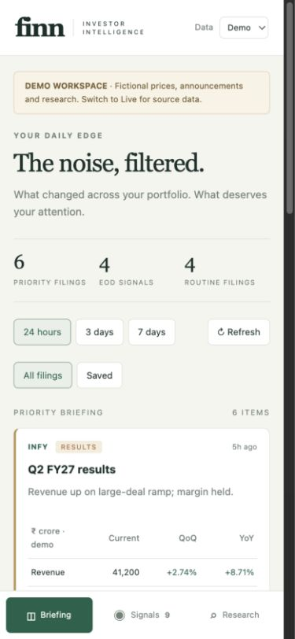
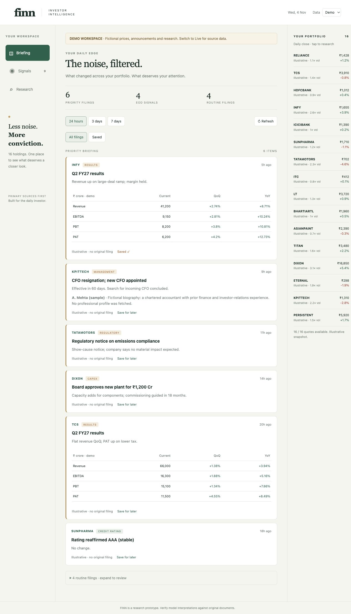

# Validation record

Checked on 4 November 2026 (Asia/Kolkata).

## Automated

- `python -m pytest -q`: **22 passed**. The local environment is Python 3.14. CI targets Python 3.12. Tests isolate the cache and mock external model calls.
- `node --check static/app.js`: passed.
- `git diff --check`: passed.
- A Starlette test-client deprecation warning is emitted by the installed framework version; the suite passes.

## Live probes

These are point-in-time integration observations, not uptime guarantees or test fixtures:

- Screener TCS discovery returned an annual-report link and four transcript links. Some transcript metadata may repeat a month; matching periods must come from document contents, not link labels.
- A TCS investor-relations transcript PDF was downloaded and text extracted: **29 pages, 54,146 characters**.
- Yahoo returned **2 / 2** requested EOD quotes for TCS and INFY. The latest returned session was 2 November 2026; the app displays session dates and does not call these intraday prices.
- NSE returned **68** portfolio announcement items within the selected seven-day window.
- **No live Gemini synthesis or financial extraction was executed:** no API key was provided. Tests validate the research orchestration and output checks with deterministic mocked model responses. Model accuracy, provider quota and end-to-end live analysis remain to be verified with a configured account.

## Browser checks

The local server was exercised through the browser at mobile (390 × 844) and desktop (1280 × 900) viewport sizes.

- Briefing renders without credentials, including distinct demo notice and collapsed routine items.
- Saving a filing and selecting Saved reduces the displayed filings to that item.
- Signal controls render; changing the volume threshold to 2.1× survives a reload.
- TCS demo research renders business and financial snapshots, guidance comparisons and a fiction notice.
- The desktop layout includes the portfolio sidebar. The document's horizontal content width matches the viewport width at the desktop breakpoint.
- Mobile navigation remains fixed at the bottom. Desktop navigation sits in the left sidebar.

Screenshots of the illustrative demo (not live financial data):

## Not claimed

No public deployment, email submission, live model accuracy evaluation, OCR validation or background push delivery was performed. Deployment configuration and a covering-note draft are included for the next step.

## Vercel preparation checks

Added tests for synchronous request-bound analysis on Vercel, `/tmp` cache selection, timeout handling and request-local budget reset. The suite now contains 26 passing tests. These tests validate runtime behavior with mocks; they do not claim a public Vercel deployment or live Gemini run.

## Public Vercel deployment

Production URL: https://finn-investor-intelligence-ashen.vercel.app

Anonymous HTTP checks returned 200 for the homepage, CSS, JavaScript, health endpoint, demo data and TCS demo research. The initial hosted live probe returned 15 portfolio quotes. NSE blocked the deployment region, so a real captured exchange snapshot (68 portfolio records) was added as a clearly dated, seven-day fallback. It preserves original timestamps and filing URLs; the UI explicitly says it is not a current live feed. Two tests cover this fallback and expiry, bringing the suite to 28 tests.

The project was deployed through Vercel Drop after the user signed in and completed Vercel's email verification. The GitHub source remains the canonical repository; pushes do not automatically redeploy this Drop project until Git integration is connected.

## Live-model check and performance adjustment

After the user configured the Vercel secret, `/api/health` reported `research_configured: true`. All four hosted demo research tickers returned 200 and seven sections. Invalid window/mode requests returned 422. The first live TCS request exceeded the 290-second client timeout; live synthesis has not been marked as passing.

Large PDFs on Vercel now extract at most 32 evenly spaced pages, retaining original page positions and partial-coverage warnings. Selected chunks from each document share one extraction call. Provider quota/configuration errors now return an actionable message. Two additional tests cover page-position preservation and provider quota errors (30 tests total).

## Model availability fix

The optimized hosted request returned Gemini HTTP 404 in 2 seconds. The configured key was recognized, but the hard-coded model ID was unavailable. Added account-supported model discovery and tests for excluding image/audio variants, choosing current stable text models and preserving explicit overrides. The suite now has 32 passing tests. Live success must still be verified after deployment.

## Synthesis latency and mobile layout

With model discovery enabled, server logs confirmed successful document extraction followed by a 90-second timeout on the final synthesis call. Added supported low/minimal thinking controls for current Gemini models and a concise output budget. A regression test checks the structured synthesis request. The suite now has 33 tests.

The production company picker, Saved filter and alert persistence were exercised in the browser. A phone-width check found horizontal overflow in the new company list; the grid and picker now explicitly allow shrinking to the viewport width.

## Transient-provider fallback

The next live request returned a provider HTTP 503. Added a deterministic test proving that managed synthesis can retry an available Flash-Lite model, return the response, preserve the actual model ID and reuse the cached result without duplicate calls. The suite has 34 passing tests. The provider-backed workflow remains under verification until a cited report is returned.
